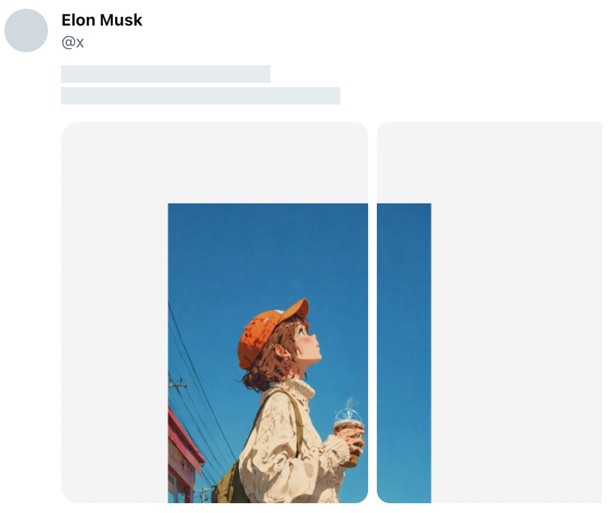

# Slice for X

Slice one picture into portrait tiles for an X post. Everything runs in the browser.

Each tile is **1646 × 2048**. Choose 1–4 tiles, set a background and corner radius, preview the post, then download a zip of PNGs.

## Run

```bash
pnpm install
pnpm dev
```

Open [http://localhost:3004](http://localhost:3004).


## Shot




## Changelog

### 0.2.0 — 2026-10-14

- Group canvas and image controls in the side panel.
- Show the app version next to the panel title.

### 0.1.2 — 2026-10-13

- Make each tile's width and height editable.
- Keep a custom background separate from the presets.

### 0.1.1 — 2026-10-12

- Place multiple images, move them, and delete the selection.
- Preview the X post before export.
- Add a welcome dialog and a New action that clears the canvas.
- Rename the app to Slice for X.

### 0.1.0 — 2026-10-12

- Slice one picture into portrait tiles and download a zip of PNGs.
- Set the background and corner radius.